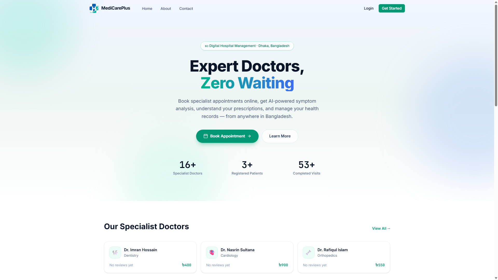
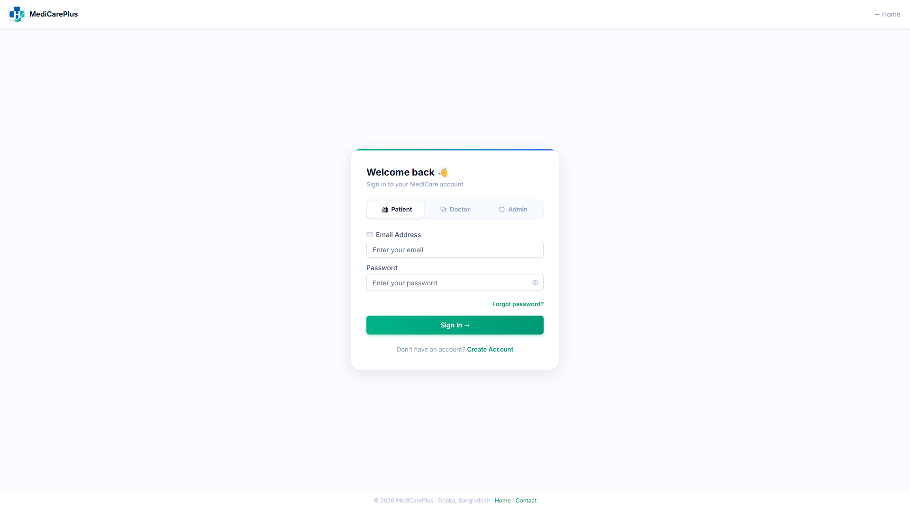
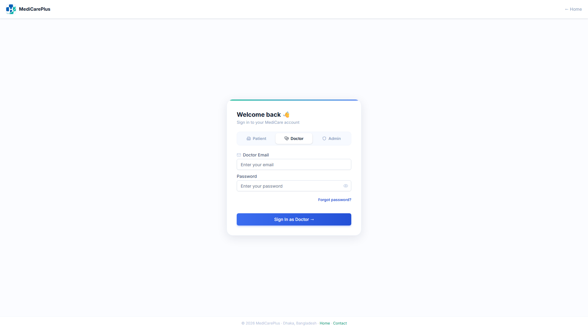
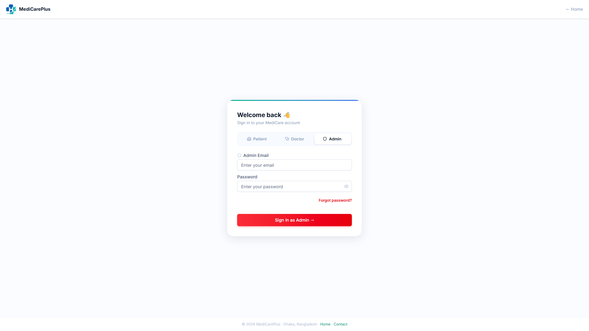
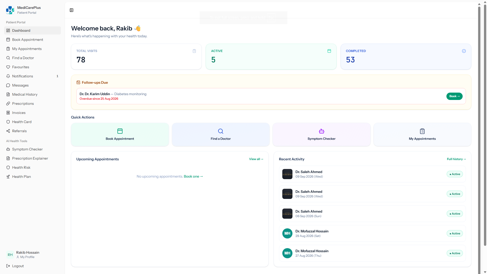
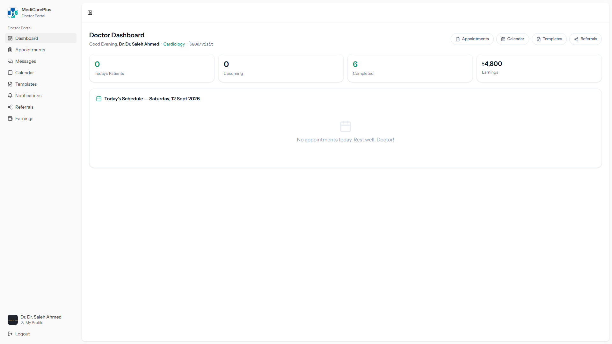
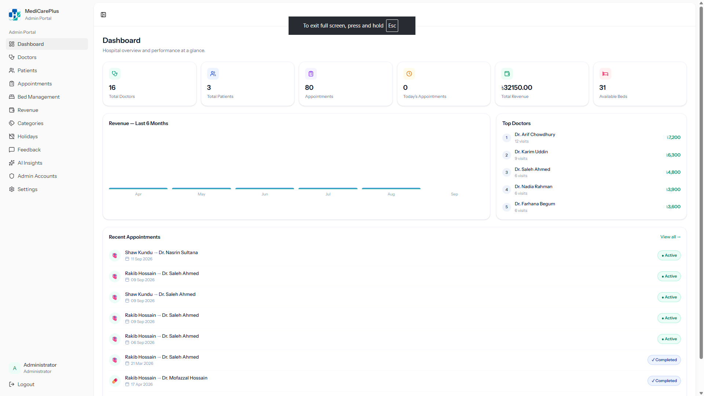
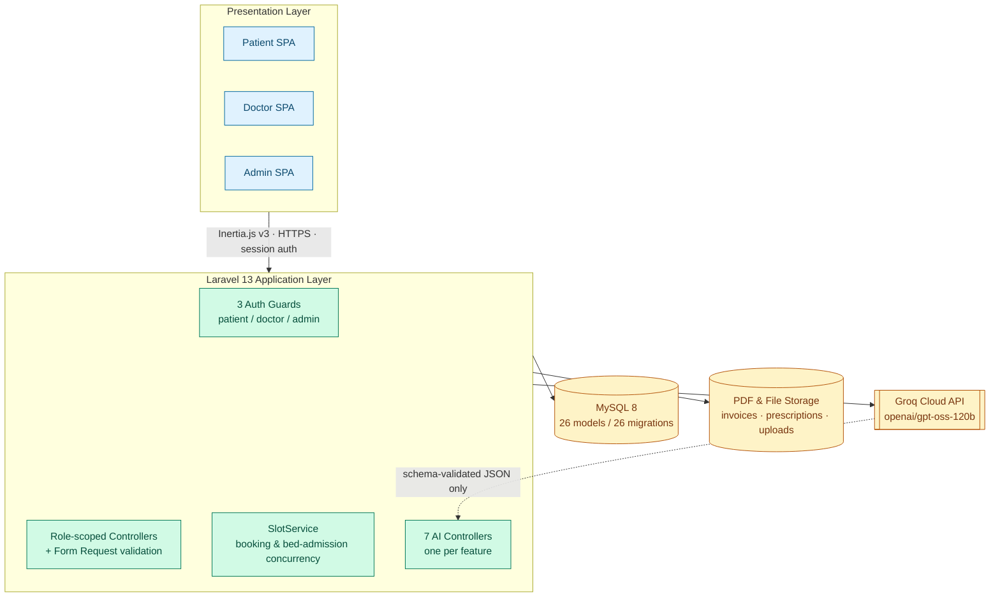
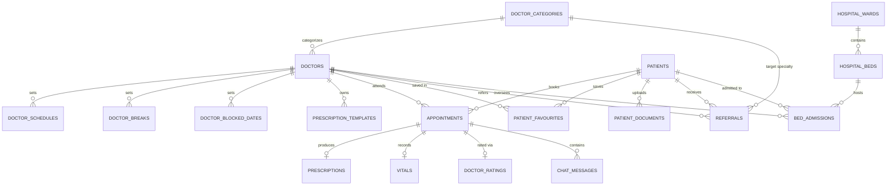

0<div align="center">



<br />

# 🏥 MediCare Hospital

### An AI-Integrated Hospital Management & Clinical Decision Support System

**Expert doctors, zero waiting — and an AI layer that reads the patient's chart before it says a single word.**

<p>


</p>
<p>


</p>

<h3>
<a href="https://youtu.be/5-jOfytR4Os">🎥 Watch the Demo</a>
<span> · </span>
<a href="https://engr-suborno-kundu.netlify.app/">🌐 Developer Portfolio</a>
<span> · </span>
<a href="#-quick-start">🚀 Quick Start</a>
<span> · </span>
<a href="#-seven-ai-features-one-rule">🧠 AI Features</a>
</h3>

*If this project is useful to you, consider dropping it a ⭐ — it genuinely helps.*

</div>

<br />

## 📚 Table of Contents

- [Screenshots](#-screenshots)
- [The Problem](#-the-problem)
- [How It Compares](#-how-it-compares)
- [Seven AI Features, One Rule](#-seven-ai-features-one-rule)
- [Core Platform Features](#-core-platform-features)
- [System Architecture](#-system-architecture)
- [Tech Stack](#-tech-stack)
- [Project Structure](#-project-structure)
- [Quick Start](#-quick-start)
- [Testing & AI Safety Validation](#-testing--ai-safety-validation)
- [Security & Privacy by Design](#-security--privacy-by-design)
- [By the Numbers](#-by-the-numbers)
- [Roadmap](#-roadmap)
- [Academic Context](#-academic-context)
- [Author](#-author)

<br />

## 📸 Screenshots

<table>
<tr>
<td width="33%" valign="top">
<b>🧑‍⚕️ Patient Portal</b><br/>
<sub>Sign in with role-aware, colour-coded auth tabs</sub>

</td>
<td width="33%" valign="top">
<b>👨‍⚕️ Doctor Portal</b><br/>
<sub>Its own guard, its own session, its own colour</sub>

</td>
<td width="33%" valign="top">
<b>🛠️ Admin Portal</b><br/>
<sub>Completely isolated — no shared <code>users</code> table</sub>

</td>
</tr>
</table>

One login screen, **three independently-authenticated guards** underneath — a patient session cannot touch a doctor route and vice versa, not because of a hidden menu, but because the guard itself doesn't exist for that role.

<table>
<tr>
<td width="33%" valign="top">
<b>Patient Dashboard</b><br/>
<sub>Visit history, follow-ups, AI health tools</sub>

</td>
<td width="33%" valign="top">
<b>Doctor Dashboard</b><br/>
<sub>Daily queue, earnings, AI briefing on tap</sub>

</td>
<td width="33%" valign="top">
<b>Admin Dashboard</b><br/>
<sub>Revenue, bed occupancy, top-doctor analytics</sub>

</td>
</tr>
</table>

<div align="center">
<a href="https://youtu.be/5-jOfytR4Os">

<br/>
<b>▶ Watch the full walkthrough on YouTube</b>
</a>
</div>

<br />

## 🎯 The Problem

In most hospitals and clinics across Bangladesh, appointment booking is a phone call, prescriptions are handwritten, and records live in paper registers. That's not just inconvenient — it removes any systematic safety net. A doctor writing a prescription by hand has no automated way of knowing whether a new drug conflicts with what the patient is already taking, or whether the patient is allergic to it. That category of error is well-documented and largely preventable.

At the same time, cloud LLMs are now fast and cheap enough to sit *inside* a real workflow instead of a research demo. **MediCare Hospital** is built on a simple thesis: don't bolt a chatbot onto a booking app. Digitise the entire hospital operation first, then wire in AI at the exact moments it can measurably reduce risk or admin burden — and never let it make an unreviewed decision.

- 🚫 No existing open-source hospital platform (OpenMRS / OpenEMR / Bahmni) ships an AI layer at all.
- 🚫 No existing Bangladeshi consumer health app (Praava Health / Doctor Appointment BD) has an operational hospital back-office.
- ✅ MediCare Hospital is the only system — of the five compared in the project's research — that does **both**, grounded in a specific patient's own stored medical record rather than the model's unaided judgement.

<br />

## 🆚 How It Compares

A structured gap analysis against three widely-used open-source clinical platforms and two Bangladeshi consumer health apps ([full methodology](#-academic-context)):

| Capability | OpenMRS | OpenEMR | Bahmni | Praava Health | DAB | **MediCare Hospital** |
|---|:---:|:---:|:---:|:---:|:---:|:---:|
| Multi-role platform (patient / doctor / admin) | Partial | Partial | Partial | ❌ | ❌ | **✅** |
| Live appointment slot booking | ❌ | ✅ | ✅ | ✅ | ✅ | **✅** |
| Bed / ward admission management | ❌ | ❌ | ✅ | ❌ | ❌ | **✅** |
| Doctor-to-doctor referrals | ❌ | ❌ | Partial | ❌ | ❌ | **✅** |
| In-app patient ↔ doctor chat | ❌ | ❌ | ❌ | Partial | ❌ | **✅** |
| **History-aware AI symptom triage** | ❌ | ❌ | ❌ | ❌ | ❌ | **✅** |
| **AI prescription safety check** | ❌ | Rule-based only | ❌ | ❌ | ❌ | **✅** |
| **Plain-language AI prescription explainer** | ❌ | ❌ | ❌ | ❌ | ❌ | **✅** |
| **AI personalised health plan** | ❌ | ❌ | ❌ | ❌ | ❌ | **✅** |
| **AI hospital-wide operational insights** | ❌ | ❌ | ❌ | ❌ | ❌ | **✅** |
| Free / open-source | ✅ | ✅ | ✅ | ❌ | ❌ | **✅** |
| Localised for Bangladesh (BDT, local credentials) | ❌ | ❌ | ❌ | ✅ | ✅ | **✅** |

The open-source platforms are operationally deep with zero AI. The Bangladeshi consumer apps are patient-friendly with zero back-office. MediCare Hospital is the row where every column is checked.

<br />

## 🧠 Seven AI Features, One Rule

> Every single AI feature reads the patient's actual stored data first — vitals, allergies, history, active medications — and returns **schema-validated JSON**, never free-form chat. None of them replace clinical judgement; the ones that matter most are explicitly overridable, and every override is logged, not silently swallowed.

| # | Feature | Role | What it does | Grounded in |
|:---:|---|:---:|---|---|
| 1 | 🩺 **Symptom Triage** | Patient | Structured urgency level + suggested specialist from typed or voice-transcribed symptoms | Vitals + medical history |
| 2 | 💊 **Prescription Explainer** | Patient | Turns a finalised prescription into a plain-language "what it's for and how to take it" | The doctor's actual prescription |
| 3 | 📈 **Health-Risk Score** | Patient | 0–100 wellness score with a category breakdown (cardiovascular, metabolic, …) | Vitals + history |
| 4 | 🥗 **Personalised Health Plan** | Patient | Diet, activity, sleep & stress-management plan — a positive plan, not just a score | Same risk-assessment data |
| 5 | 📋 **Pre-Consultation Briefing** | Doctor | One-screen summary of a patient's history, past diagnoses, and red flags before the consult starts | Full patient chart |
| 6 | ⚠️ **Prescription Safety Check** | Doctor | Flags allergy conflicts, drug–drug interactions, contraindications, dosage issues & duplicate therapy — **overridable, never silent** | Allergy history + active medications |
| 7 | 📊 **Hospital-Wide Insights** | Admin | Narrative report on revenue trend, demand by specialty, doctor performance & cancellation rates | Aggregated hospital data |

**Engineering pattern, not seven one-offs:** every feature shares the same pipeline — fetch from Eloquent models (never raw text) → build a fixed prompt template → call the Groq API (`openai/gpt-oss-120b`) with a JSON-schema constraint → validate the response server-side → render or persist. A per-user cap of **20 AI calls/hour** and automatic retry on Groq's `429` response protect the whole system.

<details>
<summary><b>🔬 Was any of this actually spot-checked? (click to expand)</b></summary>

<br />

Yes — against real production code paths, not mocks, though this is deliberately **not** claimed as a clinically-validated benchmark:

| Feature | Cases tested | Result |
|---|---|---|
| AI Prescription Safety Check | 14 hand-picked cases — drug–drug interactions, allergy conflicts, contraindications, duplicate therapy, safe controls | **14 / 14 correct** |
| AI Symptom Triage | 10 cases — 5 textbook emergencies, 4 clearly routine, 1 deliberately borderline (3-week dry cough) | **9 / 9 unambiguous cases correct**, borderline case discussed separately |
| AI Pre-Consultation Briefing | 5 patients, 5 different documented allergies | **5 / 5** allergies surfaced |
| AI Prescription Explainer | 5 prescriptions, 1–4 medicines each | **5 / 5** — every medicine listed, none invented |

No feature was evaluated against a clinically-labelled gold-standard dataset, and the report says so explicitly — the literature on general-purpose LLMs as drug-interaction checkers reports an F1 as low as 0.26 without structured input, which is exactly why every safety-relevant feature here is designed as clinician-*supervised* decision support, never an autonomous one. A full clinically-supervised accuracy study is listed as future work.

</details>

<br />

## 🩺 Core Platform Features

<table>
<tr>
<td width="33%" valign="top">

**🧑‍⚕️ Patient**
- Search specialists, book live slots in a 3-step flow
- Digital prescriptions & PDF invoices
- Vitals trend, full medical history, health card
- Favourites, referrals, in-app chat, notifications
- All 4 patient-facing AI tools

</td>
<td width="33%" valign="top">

**👨‍⚕️ Doctor**
- Daily queue + personal schedule / blocked dates
- Prescriptions with reusable templates
- AI pre-consultation briefing & safety check
- Refer patients to other doctors
- Earnings, ratings, in-app chat

</td>
<td width="33%" valign="top">

**🛠️ Admin**
- Full CRUD — doctors, patients, categories, holidays
- Bed / ward admission with live occupancy
- Revenue reporting & analytics
- AI-generated hospital-wide insights
- Admin account management

</td>
</tr>
</table>

<br />

## 🏗️ System Architecture



Three role-scoped Vue 3 SPAs share **one Laravel codebase** through Inertia.js — no separate REST/GraphQL contract to keep in sync. Underneath, three fully independent Eloquent authentication guards (not a `users` table with a `role` column) make cross-role access a structural impossibility rather than a convention that can be forgotten on one route.

<details>
<summary><b>🗄️ Entity-relationship diagram (click to expand)</b></summary>



26 Eloquent models in total. A few supporting tables sit outside this core graph: `staff_admins` (admin logins), `hospital_holidays`, `hospital_settings`, `contacts`, `login_attempts`, `password_reset_codes`, `notifications`.

</details>

<br />

## 🛠️ Tech Stack

| Layer | Technology |
|---|---|
| **Backend** | Laravel 13 · PHP 8.5 |
| **Frontend** | Vue 3 · TypeScript · Inertia.js v3 |
| **UI** | Tailwind CSS v4 · reka-ui / shadcn-vue · Lucide icons |
| **Database** | MySQL 8 (production) · SQLite (automated tests) |
| **AI Inference** | Groq Cloud API — `openai/gpt-oss-120b`, structured JSON-schema prompting |
| **PDF Generation** | barryvdh/laravel-dompdf |
| **Testing** | Pest — 74 feature tests across 12 files |
| **Code Quality** | Laravel Pint, PHPStan (Larastan), ESLint, Prettier |
| **Tooling** | Vite, Laravel Wayfinder (typed route helpers) |

<br />

## 📁 Project Structure

```
app/Http/Controllers/
  Auth/               Login, registration, password reset — 3 independent guards
  Patient/             Dashboard, booking, symptom triage, explainer, risk, health plan
  Doctor/               Dashboard, AI pre-consultation briefing, AI safety check
  Admin/                Dashboard, AI hospital insights, bed/ward management
app/Models/            26 Eloquent models
app/Services/
  SlotService.php      Single source of truth for booking & bed-admission concurrency
resources/js/pages/    Inertia page components (Vue), grouped by role
resources/js/components/  Shared reka-ui / shadcn-vue component library
database/migrations/   Full schema history — 26 migrations
tests/Feature/          Pest feature tests — 74 cases / 12 files
```

<br />

## 🚀 Quick Start

**Requirements:** PHP **8.5+** *(hard requirement — a core Laravel dependency uses PHP 8.4+ property-hook syntax; the app won't boot on 8.3)*, Composer 2, Node.js 20+, MySQL 8+ (or MariaDB).

```bash
# 1. Clone and install dependencies
git clone https://github.com/<your-username>/medicare-hospital.git
cd medicare-hospital
composer install
npm install

# 2. Environment
cp .env.example .env
php artisan key:generate
```

Then edit `.env`:
- Create a MySQL database first (migrations don't create it for you) and set `DB_DATABASE`, `DB_USERNAME`, `DB_PASSWORD`
- Add `GROQ_API_KEY` for the 7 AI features — without a key they fail gracefully with an "API not connected" message instead of crashing
- Set `ADMIN_USERNAME` / `ADMIN_PASSWORD` — the first successful login with these bootstraps the admin account automatically

```bash
# 3. Database
php artisan migrate --seed

# 4. Storage link — skip this and uploaded documents will 404
php artisan storage:link

# 5. Build & serve
npm run build
php artisan serve
```

For active development, `composer run dev` starts the PHP server, the queue listener, and the Vite dev server together in one terminal.

### 🔑 Demo Accounts

Seeded automatically by `php artisan migrate --seed`:

| Role | Login | Notes |
|---|---|---|
| Patient | `test@patient.com` | Pre-seeded with a full visit history, prescriptions & vitals — so the AI briefing and safety-check features have real data to work against |
| Doctor | any seeded doctor email, e.g. `saleh.ahmed@medicare-bd.com` | Password pattern: first name + `123`, e.g. `saleh123` |
| Admin | value of `ADMIN_USERNAME` in `.env` | Auto-created on first login with the matching `ADMIN_PASSWORD` |

<br />

## 🧪 Testing & AI Safety Validation

```bash
php artisan test
```

**74 automated tests across 12 files** — 40 fully deterministic + 34 that call the live Groq API end-to-end:

| Area | What's covered |
|---|---|
| Authentication | Login lockout, session handling, enumeration-safe password reset |
| Authorization | A patient session can never reach a doctor/admin-only route, and vice versa |
| Patient Privacy | One patient can never read another patient's data, from any endpoint |
| Booking Concurrency | Two simultaneous bookings can never both claim the same slot (DB-level locking, not app-level) |
| Bed Admission | The same concurrency guarantee, applied to ward admission |
| Admin CRUD Safety | The last admin account can't be deleted; deleting a doctor preserves their prescription/appointment history |
| 4× AI Spot-Check Suites | Symptom Triage, Prescription Safety Check, Prescription Explainer, Pre-Consultation Briefing — each hits the real Groq API and validates the response against its JSON schema |

<br />

## 🛡️ Security & Privacy by Design

- **Three separate Eloquent auth guards** (`patient`, `doctor`, `admin`) — not a single `users` table with a role column
- Passwords hashed with **bcrypt**; login lockout after repeated failed attempts
- Password-reset codes are hashed at rest, rate-limited, and return an **identical response whether or not the email exists** — prevents account enumeration
- Double-booking and double bed-admission are blocked at the **database transaction level** (row locking), not just in application code
- AI prompts are built from data-minimised Eloquent queries — each feature only ever sees the fields it actually needs
- ⚠️ **Known, documented gap:** no Content-Security-Policy header yet — deliberately not shipped until it can be authored against the app's real script/style sources and tested, rather than guessed at

<br />

## 📊 By the Numbers

| Metric | Value |
|---|---|
| Lines of PHP | ~10,100 |
| Lines of Vue / TypeScript | ~17,700 |
| Eloquent models | 26 |
| Database migrations | 26 |
| Automated tests | 74 (12 files) |
| AI-powered features | 7 |
| Seeded doctors | 16, across 15 specialties |
| AI rate limit | 20 calls / user / hour |
| Comparable platforms it out-features | 5 / 5 |

<br />

## 🗺️ Roadmap

- 💳 Local payment gateway integration — bKash, Nagad, SSLCommerz
- 📩 Automated SMS/email appointment reminders + no-show detection
- 🔌 WebSocket-based real-time chat (currently reliable polling, not push)
- 🔁 A fallback AI provider / self-hosted open-weight model, so the 7 AI features degrade gracefully if Groq is rate-limited or down
- 📚 Retrieval-augmented generation over local clinical guidelines, so the symptom checker and safety check can cite an explicit, local source instead of relying on general model knowledge
- 🔒 A properly authored and tested Content-Security-Policy header

<br />

## 🎓 Academic Context

MediCare Hospital began as a **Final Year Design Project** for the B.Sc. in Computer Science & Engineering at **Daffodil International University**, Dhaka — supervised by **Amit Chakraborty Chhoton** and co-supervised by **Shah Md. Tanvir Siddiquee**, Department of CSE. It was evaluated by a board of four examiners and defended in September 2026.

The accompanying report includes a full literature review on AI in hospital management and clinical decision support, a structured five-platform gap analysis, a Data Flow Diagram, requirement specifications, a risk analysis for every AI feature, and a mapping to the Complex Engineering Problem / Activity framework — available in this repository for anyone who wants the full research behind the code, not just the code.

<br />

## 👨‍💻 Author

**Suborno Kundu**
Computer Science & Engineering, Daffodil International University

[](https://engr-suborno-kundu.netlify.app/)
[](https://youtu.be/5-jOfytR4Os)

<br />

## 📜 License

Released under the **MIT License**. Free to use, learn from, and build on.

<div align="center">

<br />

**If MediCare Hospital was interesting or useful to you, a ⭐ goes a long way.**

</div>
